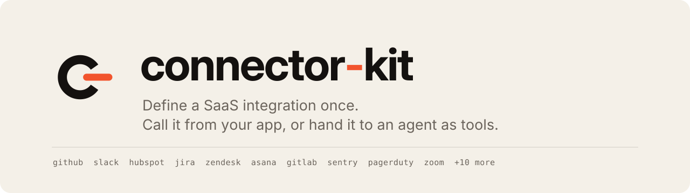

<p align="center">
  <picture>
    <source media="(prefers-color-scheme: dark)" srcset="docs/assets/banner-dark.svg">
    
  </picture>
</p>

[](https://github.com/itzzzzzzak/connector-kit/actions/workflows/ci.yml)
[](LICENSE)

[](https://github.com/itzzzzzzak/connector-kit/releases)


**Define a SaaS integration once. Call it from your app, or hand it to an AI agent as tools.**

connector-kit is an open-source TypeScript library for building and running connectors to external APIs. You describe *what* an API looks like (its actions, inputs, outputs, pagination), and the runtime handles *how* to call it safely: validation, authentication, rate limits, retries, pagination, and error normalization.

It is designed **agent-first**. Every action is a typed, validated, LLM-readable tool, and the same definition also gives you a normal developer SDK.

> **Status: pre-1.0.** The core (validation, OAuth, token storage, retries, pagination, MCP server) is tested end to end, and **49 connectors cover about 13,200 API actions**. Only GitHub has been run against its real API so far; the rest are built from official API descriptions and tested against fake servers (see [Connectors](#connectors)). Expect breaking changes until 1.0. Distributed from GitHub Releases, not npm.

## Why

Every product that talks to third-party APIs re-implements the same plumbing, and every AI agent that calls tools needs it to be *safe*: a model can invent arguments, repeat a call in a loop, or be steered by text inside an API response. connector-kit puts that plumbing, and those guardrails, in one small, permissively licensed (MIT) library instead of in every integration.

It is a **library, not a platform**: no server to run, no dashboard, no hosted service. It covers a lot of ground (43 providers, whole APIs) but stays small to adopt: you import only the connector you use, and nothing runs until you call it. It competes on being embeddable and safe by default.

## Safe by default

These are tested rules, not promises:

- **Every action says what it does.** Each is marked `read`, `write` or `destructive`, and your `beforeExecute` policy decides what may run. Deleting, refunding, banning and the like are `destructive`.
- **Retries never duplicate a write.** Reads retry after a timeout or 5xx. A write is retried only when it is safe to (Stripe-style idempotency keys), otherwise it fails once and says so.
- **Secrets stay out.** Credentials never appear in errors, logs or tool output.
- **A model cannot reach another server.** Hosts and paths are validated, so an invented argument cannot send your token elsewhere.
- **Bounded output.** Lists return one page at a time with a cursor, and large responses are capped, so an agent cannot flood its own context.

## Install

connector-kit is distributed from **GitHub Releases**, not npm. Each release has a prebuilt tarball (with a `SHA256SUMS` file) that works with npm, pnpm, yarn and bun, and needs no build step or install scripts:

```bash
npm install https://github.com/itzzzzzzak/connector-kit/releases/download/v<version>/connector-kit-<version>.tgz
```

Pick a `<version>` (the latest is `0.5.0`) from the [Releases page](https://github.com/itzzzzzzak/connector-kit/releases). To hack on it instead, clone and build:

```bash
git clone https://github.com/itzzzzzzak/connector-kit && cd connector-kit
pnpm install && pnpm build
```

Then import the core from `connector-kit` and each connector from its own subpath, e.g. `connector-kit/github`.

## Quickstart

```bash
pnpm build && GITHUB_TOKEN=<a GitHub token with read access> pnpm example:quickstart
```

The example ([examples/quickstart.ts](examples/quickstart.ts)) calls the real GitHub API:

```ts
import { createConnectorKit } from "connector-kit"
import { github } from "connector-kit/github"

const kit = createConnectorKit({
  // You decide policy; the kit just asks. Here, nothing destructive runs.
  beforeExecute: ({ effect }) =>
    effect === "destructive" ? { allow: false, reason: "destructive actions are disabled" } : { allow: true },
})

// One connection = one end user's account.
const gh = kit.connect(github, { connectionId: "user_42", credentials: { token } })

// As a developer SDK: typed in, typed out. One bounded page per call.
const repo = await gh.execute("repos.get", { owner: "octocat", name: "Hello-World" })
const page = await gh.execute("issues.list", { owner: "octocat", name: "Hello-World" })
//    page = { items: [...], nextCursor: string | null }

// Or loop over everything (developer convenience; agents use one page at a time):
for await (const issue of kit.paginate(gh, "issues.list", { owner: "octocat", name: "Hello-World" })) {
  /* ... */
}

// As agent tools: pass these to an LLM API.
const tools = kit.toTools(gh) // [{ name: "github_issues_list", description, inputSchema, run }, ...]
const result = await tools[0].run({ owner: 123 }) // -> { ok: false, error: { code: "invalid_input", ... } }
```

## Connecting your users' accounts (OAuth)

For a product with many users, each user connects their own account. connector-kit runs **no server**: you host two routes, and the kit does the security-sensitive parts (state, PKCE, token storage, refresh).

```ts
import { createConnectorKit, createEncryption, encryptedStore, generateEncryptionKey, memoryTokenStore } from "connector-kit"
import { github } from "connector-kit/github"

const kit = createConnectorKit({
  // memoryTokenStore() is for trying it out. In production use a durable store and keep the key in a secret manager.
  tokenStore: encryptedStore(memoryTokenStore(), createEncryption({ current: "k1", keys: { k1: process.env.ENCRYPTION_KEY! } })),
  oauth: { github: { clientId: "...", clientSecret: "...", redirectUri: "https://yourapp.com/callback" } },
})

// Route 1: user clicks "Connect GitHub"
const { url } = await kit.startAuth(github, { connectionId: user.id }) // add scopes: ["repo"] for private repos
redirect(url)

// Route 2: GitHub sends the user back to https://yourapp.com/callback?code=...&state=...
await kit.finishAuth(github, { code, state, expectedConnectionId: user.id })

// Anywhere later: no token handling. Expired tokens are refreshed for you.
const gh = kit.connect(github, { connectionId: user.id })
await gh.execute("repos.get", { owner: "octocat", name: "Hello-World" })
```

A runnable version is [examples/oauth-server.ts](examples/oauth-server.ts). What the kit does for you, and why ([ADR-014](docs/adr/0014-oauth-and-token-store.md)):

| Risk | How it is handled |
|---|---|
| Forged login (CSRF) | A random `state`, stored server-side, **single use**, expires in 10 minutes, bound to the `connectionId`. `expectedConnectionId` rejects a login started for someone else. PKCE (S256) is on by default. |
| Tokens stolen from the database | `encryptedStore`: AES-256-GCM, a fresh nonce per value, and the record's key bound in as authenticated data, so records cannot be swapped between users. Key rotation is supported. |
| Expired tokens | Refreshed silently shortly before expiry. A rotating refresh token is saved. |
| The refresh race | Concurrent calls refresh **once** (a lock plus re-reading the record inside it); important because many providers invalidate a refresh token the moment it is used. |
| Token expires mid-call | A `401` triggers one refresh and one retry (safe for any action: the provider rejected the request). |
| A dead connection | A revoked refresh token deletes the record; callers get `auth_expired`, then `not_connected`. A transient provider error never logs a user out. |
| Secrets in errors | Provider free text lives only in the non-enumerable `error.raw`. Token and authorize URLs must be https. |

`TokenStore` is a small interface (`get/set/delete`, `putTemp/takeTemp`, `withLock`). **A store shared by several servers must implement `withLock` across processes**, or the refresh race comes back. Two are included:

- `memoryTokenStore()`: for trying it out and tests. Nothing survives a restart, and its lock covers one process only.
- `postgresTokenStore(pool)`: durable, and its lock works **across servers**. Pass any `pg` pool (or anything with `query(text, values)`); call `await store.migrate()` once (or run `store.schemaSql()` in your own migrations). Wrap it: `encryptedStore(postgresTokenStore(pool), encryption)` so the table only ever holds ciphertext. Expiry uses the database's clock, `takeTemp` is one atomic `DELETE ... RETURNING`, and the lock is a lease row (no connection is held while waiting; a crashed server's lease expires), tested against a real Postgres in CI.

Writing your own store (Redis, DynamoDB, ...)? The shared contract in [src/store-contract.test.ts](src/store-contract.test.ts) is the spec your store must pass.

## Use it from Claude, Cursor, or any MCP client

connector-kit includes an [MCP](https://modelcontextprotocol.io) server, so any MCP host can use your connectors as tools with no code. It is **read-only by default**: the host is driven by a model, so actions that change data are refused unless you opt in with `--allow-writes`, and destructive actions are never allowed through this command.

```bash
# Claude Code (use an absolute path; prefer a fine-grained, read-only GitHub token)
claude mcp add github -e GITHUB_TOKEN=<token> -- node /abs/path/to/connector-kit/dist/bin/mcp.js github
claude mcp add slack -e SLACK_BOT_TOKEN=<xoxb-token> -- node /abs/path/to/connector-kit/dist/bin/mcp.js slack
claude mcp add stripe -e STRIPE_API_KEY=<rk_test_...> -- node /abs/path/to/connector-kit/dist/bin/mcp.js stripe --group customers,invoices,balance
```

Claude Desktop (`claude_desktop_config.json`) and Cursor (`.cursor/mcp.json`) use the same shape:

```json
{
  "mcpServers": {
    "github": {
      "command": "node",
      "args": ["/abs/path/to/connector-kit/dist/bin/mcp.js", "github"],
      "env": { "GITHUB_TOKEN": "<token>" }
    }
  }
}
```

If you installed the release tarball, the command is `node_modules/.bin/connector-kit-mcp github`. Options: `--only repos.get,issues.list` (expose fewer tools, which saves model context), `--group issues,repos` (expose whole groups; required for connectors with more than 40 actions, like GitHub's 1,190), `--allow-writes`, and `--var name=value` for connectors whose address depends on your account (for example `claude mcp add zendesk -e ZENDESK_CREDENTIALS='you@co.com/token:API_TOKEN' -- node .../mcp.js zendesk --var subdomain=acme`). `--list` shows which connectors need which.

To embed it in your own program instead, with your own policy, use `connector-kit/mcp`:

```ts
import { serveMcp } from "connector-kit/mcp"
await serveMcp(kit.toTools(connection))
```

The server is dependency-free and is tested against the official MCP SDK's client ([ADR-013](docs/adr/0013-mcp-server.md)).

## Writing a connector

A connector is a declarative description. Zod schemas give you compile-time types, runtime validation, and the JSON Schema that LLMs need, from one definition:

```ts
import { defineConnector, linkHeaderPagination } from "connector-kit"
import { z } from "zod"

export const github = defineConnector({
  name: "github",
  baseUrl: "https://api.github.com",
  auth: { type: "bearer" },
  actions: {
    "repos.get": {
      description: "Get details about a GitHub repository. Use when the user asks about a specific repo.",
      method: "GET",
      path: "/repos/{owner}/{name}",
      input: z.object({ owner: z.string(), name: z.string() }),
      output: repository,
      effect: "read", // "read" | "write" | "destructive": your policy hook decides what to allow
    },
    "issues.list": {
      description: "List issues in a repository. Returns one bounded page; pass nextCursor to get more.",
      method: "GET",
      path: "/repos/{owner}/{name}/issues",
      input: z.object({ owner: z.string(), name: z.string(), cursor: z.string().optional(), pageSize: z.number().optional() }),
      output: z.array(issue),
      effect: "read",
      paginate: linkHeaderPagination(), // provider paging mechanics live in a reusable strategy
    },
  },
})
```

See [src/connectors/github](src/connectors/github/index.ts) for the full reference connector. To add one, create `src/connectors/<name>/` and a subpath export; see [CONTRIBUTING.md](CONTRIBUTING.md).

## What the runtime does for you

| Concern | Behavior |
|---|---|
| **Input** | Validated before any network call (models invent arguments). Path parameters cannot escape their segment (`..` is rejected), and every request, including pagination cursors, must stay under the connector's base URL. |
| **Errors** | A small fixed set (`auth_expired`, `forbidden`, `rate_limited`, `not_found`, `invalid_input`, `denied`, `upstream_error`), each with `retryable` and a message written for a model. Provider detail lives in a non-enumerable `error.raw`, so it stays out of logs. |
| **Rate limits** | `429` (and GitHub-style `403`) wait for `Retry-After` within a shared 30 s budget; longer waits return `rate_limited` with `retryAfter` instead of hanging your function or agent. |
| **Retries** | Exponential backoff with jitter. Failures where the outcome is unknown (timeout, `5xx`) are retried **only for reads or actions marked `safeToRetry`**, so a retry cannot create a duplicate. |
| **Pagination** | One bounded page per call (default 30, capped per provider) plus an opaque `nextCursor`. Works for providers that page by `Link` header (GitHub), a cursor or next-link inside the body (Slack, DigitalOcean), and offsets or page numbers (PagerDuty, Mailchimp). The same primitive serves agents and developers. |
| **"200 OK" that failed** | Providers like Slack report errors inside a successful response. A connector's `detectError` hook maps them to the normal error codes, so retries and token refresh behave as for any other failure. |
| **Timeouts and size** | Every attempt has a deadline (30 s) and responses are size-capped (1 MB). |
| **Secrets** | Tokens appear only in the outgoing auth header: never in errors, tool results, or `JSON.stringify(error)`. |
| **Policy** | An optional `beforeExecute` hook sees each call's `effect` and validated input and can allow or deny (async, so a human can approve). It **fails closed**: if the hook throws, the action does not run. |

The reasoning behind each decision is in [docs/adr](docs/adr), and the design overview is in [docs/notebook.md](docs/notebook.md).

## Roadmap

- [x] Core runtime: `defineConnector`, validated `execute`, normalized errors, retries, bounded rate-limit waiting
- [x] Pagination for Link headers, body cursors, next-links, offsets and page numbers
- [x] `toTools()` and the `beforeExecute` policy hook
- [x] OAuth 2.0 with PKCE, refresh with locking, encrypted token storage (memory and Postgres)
- [x] MCP server (`connector-kit/mcp` and the `connector-kit-mcp` command), with `--group` filtering
- [x] HTTP Basic auth and per-account base URLs (Zendesk, Jira, Mailchimp, Sentry)
- [x] 22 connectors with full API coverage, generated from official API descriptions ([ADR-018](docs/adr/0018-full-api-coverage-and-groups.md))
- [x] Form-encoded requests, idempotency keys and last-item paging, for Stripe ([ADR-019](docs/adr/0019-form-bodies-idempotency-and-last-item-paging.md))
- [ ] Full coverage for Airtable and Calendly (no official machine-readable description; hand-written)
- [x] Cursor paging inside a POST body and JSON OAuth token requests, for Notion ([ADR-020](docs/adr/0020-body-cursor-paging-and-json-token-requests.md))
- [x] GraphQL actions with Relay paging and GraphQL error mapping, for Linear ([ADR-021](docs/adr/0021-graphql-actions.md))
- [x] Google Workspace as thirteen connectors generated from Discovery documents, with `{+name}` path values ([ADR-022](docs/adr/0022-google-workspace-connectors.md))
- [x] Twilio as three connectors, with next-page links that are paths ([ADR-023](docs/adr/0023-twilio-products-and-relative-next-links.md))
- [x] Discord as a bot, with paging by the last id and mentions off by default ([ADR-024](docs/adr/0024-discord-bot-connector-and-last-id-paging.md))
- [x] Datadog with two keys in two headers ([ADR-025](docs/adr/0025-multi-header-api-keys-and-datadog.md))
- [x] Microsoft 365 as Outlook, OneDrive and Teams connectors over Microsoft Graph ([ADR-026](docs/adr/0026-microsoft-365-connectors.md))
- [ ] Promote connectors to `live-tested` as they are run against real accounts
- [ ] Webhook verification and delivery de-duplication

Have an idea or a connector you need? [Open an issue](https://github.com/itzzzzzzak/connector-kit/issues/new/choose).

## Connectors

The catalog is in [docs/connectors.md](docs/connectors.md) (49 connectors, about 13,200 actions: GitHub, Stripe, Notion, Linear, Salesforce, Shopify, Discord, Twilio, Twilio Verify, Twilio Lookups, Gmail, Google Calendar, Drive, Sheets, Docs, Slides, Tasks, Contacts, Forms, Meet, Chat, Admin and Classroom, Slack, Asana, HubSpot, Airtable, Calendly, Zoom, GitLab, Netlify, DigitalOcean, Vercel, Pipedrive, Intercom, Figma, Zendesk, Jira, PagerDuty, Mailchimp, ClickUp, Sentry, Datadog, Outlook, OneDrive, Microsoft Teams, Resend, SendGrid, Supabase), generated from each connector's own metadata. Every connector is marked **`live-tested`** (run against the real API) or **`docs-based`** (written from the provider's official docs and tested against a fake server, **not** run live). We do not blur the two. See ADR-016 for the plan and [docs/writing-connectors.md](docs/writing-connectors.md) to add one: `pnpm new:connector <name>` scaffolds it, and an automatic check over every connector keeps them consistent.

**Big connectors are used by group.** GitHub alone has about 1,190 actions, far too many to give a model at once. Actions are named `group.verb` (for example `issues.create`); expose a group with `--group issues,repos` (MCP) or `kit.toTools(connection, { groups: ["issues"] })`, or single actions with `only`. The MCP command refuses to start a connector with more than 40 actions unless you choose. Most actions are generated from the provider's official API description; the important ones are hand-written with typed results and take precedence by name. Generated actions are never marked safe to retry, and writes are blocked over MCP unless you pass `--allow-writes`.

List what you can serve over MCP with `connector-kit-mcp --list`.

## What's in the box

| Path | Purpose |
|---|---|
| [`connector-kit`](src) | The runtime (`defineConnector`, `createConnectorKit`, retries, pagination, `toTools()`, policy hook) |
| [`connector-kit/github`](src/connectors/github) | GitHub connector (reference implementation, the only `live-tested` one) |
| `connector-kit/<name>` | Every connector in [the catalog](docs/connectors.md) has its own import path |
| [`connector-kit/mcp`](src/mcp.ts) | MCP server over stdio, plus the `connector-kit-mcp` command |
| [`examples/`](examples) | Runnable examples |
| [`docs/`](docs) | Design notebook and [architecture decision records](docs/adr) |

## Non-goals

A hosted service, a UI, a data-sync engine, a workflow engine, an agent loop, or a built-in policy engine. Those belong in other layers that can be built *on top of* this library.

## Contributing

Contributions are welcome, especially connectors. Read [CONTRIBUTING.md](CONTRIBUTING.md) first. Security issues: [SECURITY.md](SECURITY.md). Maintainers: [MAINTAINING.md](MAINTAINING.md). Participation is governed by the [Code of Conduct](CODE_OF_CONDUCT.md).

## License

[MIT](LICENSE)
